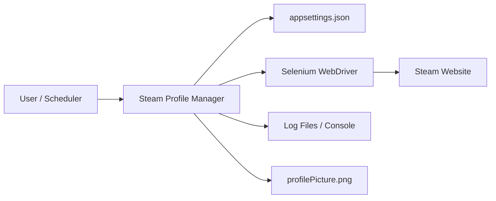
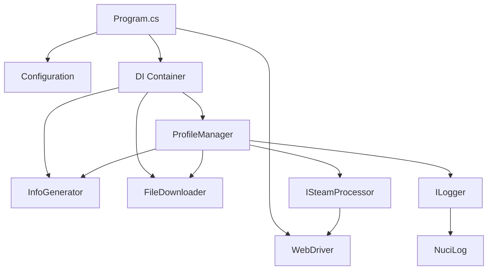
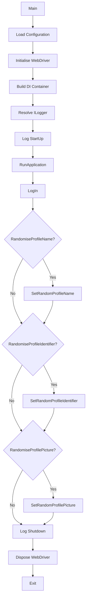
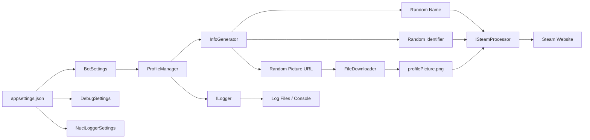
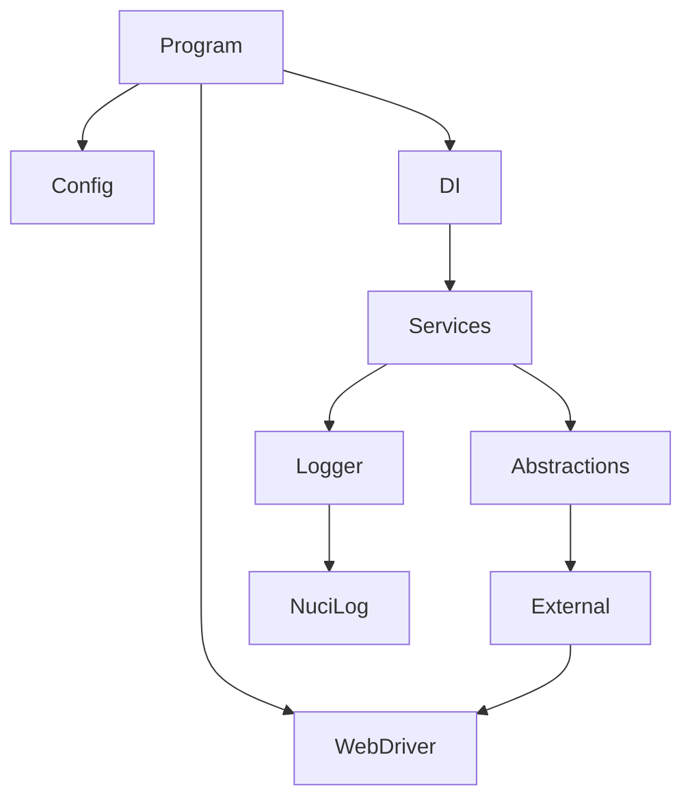

# Steam Profile Manager Architecture

This document describes the current architecture of the Steam Profile Manager application, a .NET console application that automates Steam profile updates through browser automation.

## 📑 Table of Contents

- [Purpose](#-purpose)
- [System Context](#-system-context)
- [Architectural Style](#-architectural-style)
- [Runtime Flow](#-runtime-flow)
- [Components](#-components)
- [Architectural Areas](#-architectural-areas)
- [Data Architecture](#-data-architecture)
- [Interfaces and Integrations](#-interfaces-and-integrations)
- [Dependency Direction and Rules](#-dependency-direction-and-rules)
- [External Dependencies](#-external-dependencies)
- [Deployment and Operations](#-deployment-and-operations)
- [Testing and Verification](#-testing-and-verification)
- [Design Constraints](#-design-constraints)
- [Source Map](#-source-map)
- [Related Documentation](#-related-documentation)

## 🎯 Purpose

Steam Profile Manager automates selected Steam profile updates including display name, custom URL identifier, and profile picture. The application targets .NET 10.0 and uses Selenium WebDriver for browser automation. It is configuration-driven through `appsettings.json` and designed for unattended execution with structured logging via NuciLog.

## 🌐 System Context



The principal external boundaries are:
- **Configuration File (`appsettings.json`):** Provides bot settings, debug settings, and logger settings. Owned by the user.
- **Steam Website:** Target of browser automation. Exchanges authentication credentials, profile data, and HTTP responses. Owned by Valve Corporation.
- **Selenium WebDriver:** Browser automation framework. Exchanges WebDriver commands and browser state. Owned by the Selenium project.
- **Log Output:** Structured logs written to console and/or file. Owned by the application via NuciLog.
- **Temporary File (`profilePicture.png`):** Downloaded profile picture stored in working directory during picture update. Owned by the application.

## 🏗️ Architectural Style

The application follows a **layered architecture** with **dependency injection** and **interface-based contracts**. The layers are:

1. **Entry Point (`Program.cs`):** Bootstraps configuration, WebDriver, DI container, and orchestrates the main flow.
2. **Configuration Layer:** Strongly-typed settings classes bound from `appsettings.json`.
3. **Service Layer:** Business logic implementations behind interfaces (`IProfileManager`, `IInfoGenerator`, `IFileDownloader`).
4. **External Integration Layer:** NuciWeb.Steam (`ISteamProcessor`) for Steam-specific web interactions; Selenium WebDriver for browser control.
5. **Logging Layer:** NuciLog with custom `MyOperation` and `MyLogInfoKey` for structured logging.



The principal architecture boundaries are:
- **Entry Point:** Owns application lifecycle, configuration loading, WebDriver initialisation, and DI composition. No business logic.
- **Configuration:** Pure data objects. No behaviour. Bound from JSON via `Microsoft.Extensions.Configuration`.
- **Services:** Implement business logic. Depend on abstractions (`IInfoGenerator`, `IFileDownloader`, `ISteamProcessor`, `ILogger`, `BotSettings`). No direct WebDriver or HTTP usage.
- **External Integrations:** `ISteamProcessor` (NuciWeb.Steam) encapsulates all Steam DOM interactions. `IFileDownloader` encapsulates HTTP downloads. `ILogger` (NuciLog) encapsulates logging.
- **Logging:** Custom operation and info keys provide domain-specific structured logging.

## 🔄 Runtime Flow



The principal runtime sequence is:
1. **Initialisation:** Load `appsettings.json`, initialise Selenium WebDriver (headless or debug mode), build DI container, resolve logger.
2. **Start-up Logging:** Log application start with `Operation.StartUp`.
3. **Login:** `ProfileManager.LogIn()` authenticates via `ISteamProcessor` using credentials and TOTP, rejects cookies.
4. **Profile Name Randomisation (optional):** `ProfileManager.SetRandomProfileName()` generates or selects a name via `IInfoGenerator`, applies via `ISteamProcessor`.
5. **Profile Identifier Randomisation (optional):** `ProfileManager.SetRandomProfileIdentifier()` generates an identifier via `IInfoGenerator`, applies via `ISteamProcessor`.
6. **Profile Picture Randomisation (optional):** `ProfileManager.SetRandomProfilePicture()` selects a URL via `IInfoGenerator`, downloads via `IFileDownloader`, uploads via `ISteamProcessor`.
7. **Shutdown Logging:** Log application shutdown.
8. **Cleanup:** Dispose WebDriver, exit.

## 🧩 Components

| Component | Responsibility | Principal Dependencies | Lifetime or Ownership |
|-----------|----------------|------------------------|-----------------------|
| `Program` | Application entry point, bootstrapping, orchestration | `BotSettings`, `DebugSettings`, `NuciLoggerSettings`, `IWebDriver`, `IServiceProvider`, `ILogger` | Singleton, owned by runtime |
| `BotSettings` | Bot configuration (timeouts, credentials, feature flags, file paths) | `SteamAccount` (NuciWeb.Steam) | Transient, bound from configuration |
| `DebugSettings` | Debug mode, crash screenshot settings | None | Transient, bound from configuration |
| `ProfileManager` | Orchestrates profile update operations | `IInfoGenerator`, `IFileDownloader`, `ISteamProcessor`, `BotSettings`, `ILogger` | Transient, DI-resolved |
| `InfoGenerator` | Generates random profile names and identifiers | None (uses `NuciExtensions`) | Transient, DI-resolved |
| `FileDownloader` | Downloads profile pictures from URLs | `WebClient` (BCL) | Transient, DI-resolved |
| `ISteamProcessor` | Steam web interactions (login, profile edits, cookie handling) | `IWebDriver` (Selenium) | Transient, provided by NuciWeb.Steam |
| `ILogger` | Structured logging with custom operations and info keys | NuciLog infrastructure | Singleton, DI-resolved |
| `MyOperation` | Domain-specific operation identifiers for logging | `Operation` (NuciLog) | Static |
| `MyLogInfoKey` | Domain-specific log info keys for structured logging | `LogInfoKey` (NuciLog) | Static |

## 🗂️ Architectural Areas

### Entry Point

Paths:
- `Program.cs`

Responsibilities:
- Configuration loading
- WebDriver initialisation
- DI container composition
- Main execution flow orchestration
- Top-level exception handling

Boundary rules:
- No business logic
- No direct Selenium or HTTP usage
- Only orchestrates resolved services

### Configuration

Paths:
- `Configuration/BotSettings.cs`
- `Configuration/DebugSettings.cs`

Responsibilities:
- Strongly-typed configuration binding
- Validation via property setters (implicit)

Boundary rules:
- Pure data objects
- No behaviour or dependencies
- Public auto-properties only

### Services

Paths:
- `Service/IProfileManager.cs`
- `Service/ProfileManager.cs`
- `Service/IInfoGenerator.cs`
- `Service/InfoGenerator.cs`
- `Service/IFileDownloader.cs`
- `Service/FileDownloader.cs`

Responsibilities:
- Business logic for profile management
- Random value generation
- File download
- Coordination of Steam operations

Boundary rules:
- Implementations depend on abstractions only
- No direct WebDriver, HTTP, or configuration access
- Logging via injected `ILogger`
- Settings via injected `BotSettings`

### Logging

Paths:
- `Logging/MyOperation.cs`
- `Logging/MyLogInfoKey.cs`

Responsibilities:
- Domain-specific operation names
- Domain-specific structured log keys

Boundary rules:
- Extend NuciLog base types only
- No external dependencies beyond NuciLog.Core
- Static factory properties only

## 💾 Data Architecture



| Data or Store | Owner | Representation and Storage | Lifecycle or Consistency |
|---------------|-------|----------------------------|--------------------------|
| `BotSettings` | `Program` / DI | POCO bound from `appsettings.json` | Application lifetime, immutable after load |
| `DebugSettings` | `Program` / DI | POCO bound from `appsettings.json` | Application lifetime, immutable after load |
| `NuciLoggerSettings` | `Program` / DI | POCO bound from `appsettings.json` | Application lifetime, immutable after load |
| `SteamAccount` | `BotSettings` | NuciWeb.Steam model (username, password, TOTP key) | Application lifetime, sensitive |
| `profileNamesList` file | User / `InfoGenerator` | Text file, one name per line | Read once per name generation if configured |
| `profilePicturesList` file | User / `InfoGenerator` | Text file, one URL per line | Read once per picture generation if configured |
| `profilePicture.png` | `FileDownloader` / `ProfileManager` | Temporary PNG file in working directory | Created during picture update, not cleaned up automatically |
| Log entries | `ILogger` / NuciLog | Structured text (console and/or file) | Retention per NuciLog configuration |

## 🔌 Interfaces and Integrations

### NuciWeb.Steam (`ISteamProcessor`)

- **Purpose:** Encapsulates all Steam website interactions.
- **Operations used:** `LogIn(SteamAccount)`, `RejectCookies()`, `SetProfileName(string)`, `SetProfileIdentifier(string)`, `SetProfilePicture(string)`.
- **Contract:** Provided by NuciWeb.Steam NuGet package. Implementation uses Selenium WebDriver internally.
- **Dependency direction:** `ProfileManager` → `ISteamProcessor` (abstraction).

### Selenium WebDriver (`IWebDriver`)

- **Purpose:** Browser automation.
- **Initialisation:** `WebDriverInitialiser.InitialiseAvailableWebDriver(bool isDebugMode, int pageLoadTimeout)` from NuciWeb.Automation.Selenium.
- **Lifecycle:** Created in `Program`, disposed on shutdown.
- **Dependency direction:** `ISteamProcessor` implementation → `IWebDriver`.

### NuciLog (`ILogger`)

- **Purpose:** Structured logging with operations and typed info keys.
- **Configuration:** `NuciLoggerSettings` from `appsettings.json`.
- **Custom extensions:** `MyOperation` (LogIn, SetProfileName, SetProfileIdentifier, SetProfilePicture), `MyLogInfoKey` (Username, ProfileName, ProfileIdentifier, ProfilePicture).
- **Dependency direction:** All services → `ILogger`.

### Microsoft.Extensions.Configuration / DependencyInjection

- **Purpose:** Configuration binding and DI container.
- **Usage:** `ConfigurationBuilder` binds JSON to POCOs. `ServiceCollection` registers services and resolves object graph.
- **Dependency direction:** `Program` → framework; services → framework via constructor injection.

### NuciExtensions

- **Purpose:** Provides `GetRandomElement()` extension on `string` for random character selection.
- **Usage:** `InfoGenerator` uses it for name/identifier generation.
- **Dependency direction:** `InfoGenerator` → NuciExtensions.

## 🧭 Dependency Direction and Rules



The principal dependency rules are:
- **Entry Point** depends on Configuration, DI, WebDriver, and Logging. No reverse dependencies.
- **Services** depend on Abstractions (`IInfoGenerator`, `IFileDownloader`, `ISteamProcessor`, `ILogger`, `BotSettings`). No direct dependencies on concrete external implementations.
- **Configuration** has no dependencies. Pure data objects.
- **Logging** extensions depend only on NuciLog.Core. No application dependencies.
- **External Integrations** (NuciWeb.Steam, Selenium, NuciLog) are depended upon via abstractions. Application code does not reference concrete implementations directly.
- **Prohibited:** Services must not reference `IWebDriver`, `WebClient`, or configuration classes directly. Entry Point must not contain business logic.

## 📦 External Dependencies

| Dependency | Responsibility | Integration Boundary | Architectural Consequence |
|------------|----------------|----------------------|---------------------------|
| `NuciWeb.Steam` | Steam website automation (login, profile edits) | `ISteamProcessor` abstraction | Encapsulates all Steam DOM logic; version updates may change selectors |
| `NuciWeb.Automation.Selenium` | WebDriver initialisation and `SeleniumWebProcessor` | `IWebProcessor` / `IWebDriver` | Abstracts browser selection; ties to Selenium API |
| `NuciLog` / `NuciLog.Core` | Structured logging with operations and info keys | `ILogger` abstraction | Custom `MyOperation`/`MyLogInfoKey` extend base types |
| `NuciExtensions` | Random element selection from strings | Direct usage in `InfoGenerator` | Minimal coupling; single extension method |
| `Microsoft.Extensions.Configuration` / `DependencyInjection` | Configuration binding and DI container | `Program` composition root | Standard .NET patterns; no architectural coupling |
| `Selenium.WebDriver` | Browser automation | Via `NuciWeb.Automation.Selenium` | Transitive; browser version compatibility required |
| `System.Net.WebClient` | HTTP file download | Via `FileDownloader` abstraction | Legacy BCL API; consider `HttpClient` for future |

## 🚀 Deployment and Operations

| Concern | Current Design | Architectural Consequence |
|---------|----------------|---------------------------|
| Process topology | Single console process, sequential execution | No horizontal scaling; run via scheduler for periodic updates |
| Persistent state | `appsettings.json` (config), `logfile.log` (logs), `profilePicture.png` (temp) | Config and logs persist; temp file not auto-cleaned |
| Startup | Load config → init WebDriver → build DI → run flow | WebDriver initialisation may fail if no browser available |
| Shutdown | `webDriver.Quit()` in `finally` block | Guaranteed cleanup on success or failure |
| Scheduling | External (cron, Task Scheduler, etc.) | Application has no internal scheduler |
| Credentials | Stored in `appsettings.json` (plaintext placeholders) | User must replace placeholders; no secret management integrated |
| Observability | NuciLog to console and file (`logfile.log`) | Structured logs with operation/info keys; no metrics or tracing |

## ✅ Testing and Verification

[SteamProfileManager.UnitTests](./SteamProfileManager.UnitTests/SteamProfileManager.UnitTests.csproj) uses NUnit 4 and Moq. Its unit tests verify that `InfoGenerator` returns profile names with exactly 12 ASCII alphanumeric characters and identifiers with exactly eight ASCII alphanumeric characters. Tests require no network access, browser, or Steam credentials.

Execute the principal automated verification with:

```bash
dotnet test SteamProfileManager.slnx
```

Material coverage gaps:
- No unit tests for `FileDownloader` or `ProfileManager`
- No integration tests for Steam automation flow
- No configuration binding tests
- No DI composition tests

## ⚠️ Design Constraints

- **Sequential execution:** Profile updates run sequentially; no parallelism.
- **Single browser instance:** One WebDriver session for entire run; no session reuse across runs.
- **No credential encryption:** `appsettings.json` stores credentials in plaintext (placeholders in repo).
- **No temp file cleanup:** `profilePicture.png` remains in working directory after picture update.
- **No retry logic:** Network or Steam UI failures terminate the run; no automatic retry.
- **Headless by default:** Debug mode (`isDebugMode: true`) runs visible browser for troubleshooting.
- **TOTP required:** Steam Guard shared secret mandatory for automated 2FA login.
- **.NET 10.0 target:** Requires .NET 10.0 SDK; not compatible with earlier runtimes.

## 🗺️ Source Map

| Area | Path |
|------|------|
| Entry Point | `Program.cs` |
| Configuration | `Configuration/` |
| Services | `Service/` |
| Logging Extensions | `Logging/` |
| Build Configuration | `SteamProfileManager.csproj` |
| Runtime Configuration | `appsettings.json` |
| Release Script | `release.sh` |
| CI Workflow | `.github/workflows/dotnet.yml` |

## 📚 Related Documentation

| Resource | Description |
|----------|-------------|
| [README.md](./README.md) | Project overview, usage, configuration, and installation |
| [LICENSE](./LICENSE) | GNU General Public License v3.0 |